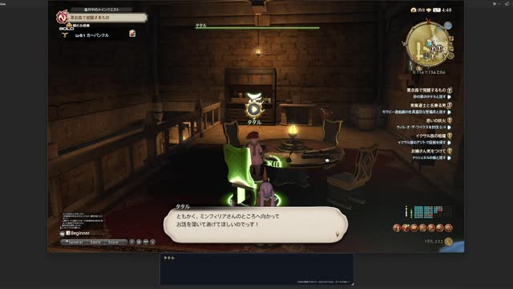
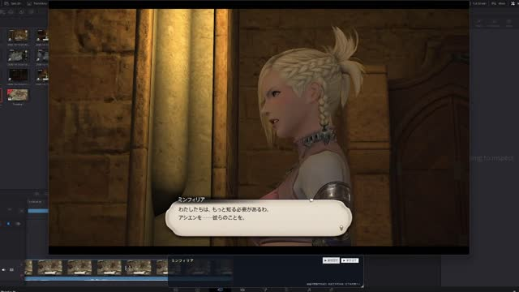
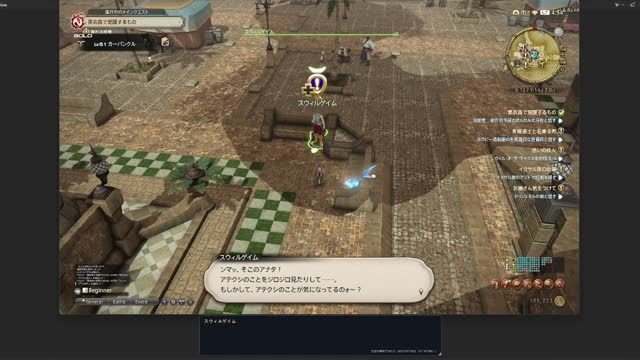
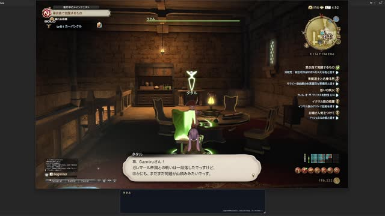
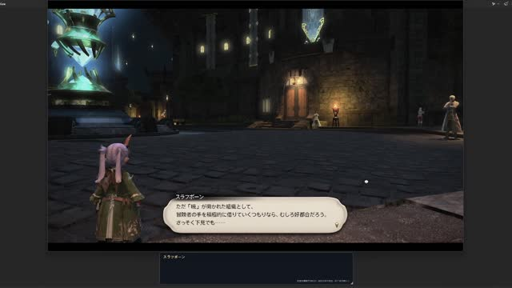

# FF14Sound

**想聽住 NPC 講故仔，仲可以配埋廣東話字幕？**

FF14Sound 係一個獨立 Windows app，為《FINAL FANTASY XIV》對白加入即時翻譯同 AI 配音。讀取遊戲中嘅 NPC 名稱及對白，用本機 VoxCPM2 生成聲音；有可用遊戲原聲樣本嘅角色可以 clone 聲線，未配對嘅 NPC 則按描述建立聲音。

可以揀 **日文原文配音＋廣東話字幕**，亦可以直接聽 **廣東話翻譯配音**。唔需要另外開 TataruHelper GUI。

> 呢個係非官方實驗專案。Repo 提供程式碼及資源重建工具；遊戲原聲、對白索引、模型權重及個人 API key 唔包含喺入面。請先用自己已安裝嘅遊戲 client 建立本機資源。

## 示範影片

以下都係 `vdo/` 入面嘅實際影片，**按預覽圖或片名開啟**。內容包含遊戲劇情；如果瀏覽器未能預覽 MOV，可從影片頁下載後播放。

| | |
| --- | --- |
| [](vdo/ctl.mov) | [](vdo/mm1.mov) |
| [▶ ctl.mov](vdo/ctl.mov) | [▶ mm1.mov](vdo/mm1.mov) |
| [](vdo/npc.mov) | [](vdo/tataru.mov) |
| [▶ npc.mov](vdo/npc.mov) | [▶ tataru.mov](vdo/tataru.mov) |

[](vdo/Timeline%201.mov)

[▶ Timeline 1.mov](vdo/Timeline%201.mov)

## 有咩功能？

- **即時翻譯**：支援 Ollama、Gemini 同 Google 翻譯，可選廣東話字幕／配音。
- **角色聲線**：按 NPC 配對日／英／德／法原聲 reference；可手動配對、用自己嘅 reference，或者編輯聲線描述。
- **冇原聲嘅 NPC 都可以講嘢**：首句按描述生成，之後保存為該角色嘅 reference，配合固定 seed 維持聲線。
- **已有錄音交返遊戲播放**：索引識別到嘅原錄音對白會略過 AI 配音，翻譯及字幕照常顯示。
- **獨立字幕視窗**：原文、譯文或雙語，支援置頂、字體、透明度、精簡模式及手動播放。
- **播放控制**：音量、保留音高嘅變速、自動平衡音量；換句會取消舊配音。
- **本機快取／背景預配**：重用已生成音檔，亦可預先建立原文配音，暫停後續跑。
- **可選官方繁中來源**：用自己嘅國際版及繁中版 client 建立日文 ID → 繁中對白配對，再翻成廣東話。

## 開始之前

| 需要 | 用途 |
| --- | --- |
| Windows x64 | WPF 桌面程式及遊戲 reader |
| .NET **10 SDK** | 編譯 app 及資源工具；只裝 Runtime 唔夠 |
| Git | 下載主 repo 同兩個 submodule |
| Python 3.10–3.12、`uv` | 安裝本機 VoxCPM 環境 |
| `ffmpeg`（加入 PATH） | 把遊戲原聲轉成 reference WAV |
| 已安裝嘅 FF14 國際版 client | 讀取日／英／德／法遊戲資源 |
| NVIDIA GPU + 相容驅動 | CUDA 配音；提供 CPU 安裝選項，但速度會受硬件限制 |

首次安裝需要下載依賴同模型，請預留磁碟空間。開發機用 RTX 3090；實際延遲受句長、模型、遊戲負載及翻譯服務影響。

## 快速上手

### 1. 下載完整 repo

喺本 repo 嘅 **Code → HTTPS** 複製網址，再執行（將 `<repo-url>` 換成嗰個網址）：

```powershell
git clone --recurse-submodules <repo-url> FF14Sound
cd FF14Sound
```

如果已經 clone：

```powershell
git submodule update --init --recursive
```

請用 Git clone；GitHub 嘅 ZIP 唔包含 submodule 內容。`TataruHelper/` 同 `VoxCPM/` 都要下載完整。

### 2. 安裝配音環境

```powershell
.\Setup-VoxCPM.cmd
# 冇 CUDA GPU 可以改用：
# .\Setup-VoxCPM.cmd -CpuOnly
```

安裝器建立 `VoxCPM/.venv`，並安裝 Gemini adapter 所需依賴。第一次生成／預載時會下載 `openbmb/VoxCPM2`，模型存喺 `.cache/huggingface/`。

### 3. 由自己嘅 client 重建遊戲資源

指定 **`game\sqpack`**，唔係 launcher 所在資料夾。以下路徑只係例子，請換成自己嘅安裝位置：

```powershell
.\Restore-GameResources.cmd -SqPack "D:\Games\FFXIV\game\sqpack"
```

工具會讀取遊戲檔，建立聲音庫、NPC 名稱表、配對證據同原錄音索引，輸出至 `data/game-voices/`；掃描報告喺 `artifacts/game-voices/`。**唔會修改遊戲檔案。** 冇傳路徑時會詢問，亦可設定環境變數 `FF14_SQPACK`。

呢步係首次使用配音嘅必要步驟：欠缺原錄音索引時，app 會暫停配音。遊戲更新後可再執行同一命令，完成後重開 app。重建會更新生成資源，包括之前挑選過嘅 reference；個人設定另存於 LocalAppData。

更多選項，包括繁中對白、預配索引、前置檢查及各輸出檔用途，見 [資源重建指南](docs/game-resources.md)。

### 4. 啟動 backend 同 app

開兩個 terminal：

```powershell
# Terminal 1：保持運行
.\Start-VoxCPM.cmd --device cuda
# CPU：.\Start-VoxCPM.cmd --device cpu
```

```powershell
# Terminal 2
.\Start-FF14Sound.cmd
```

Backend 測試頁：<http://127.0.0.1:8808>。可以先用 web UI 試文字生成／clone，或喺 app 按「預載 VoxCPM」減少第一句等待時間。

### 5. 揀翻譯同配音方式

1. 設定「遊戲文字語言」、翻譯目標（例如廣東話），同「配音內容」：原文配音或翻譯配音。
2. 設定翻譯引擎。預設係 **Ollama**，需自行準備可用服務及文字模型；填 API base URL，按「更新模型」，揀已安裝模型。亦可改選 Google，或用自己 API key 設定 Gemini。
3. 「Clone 原聲版本」決定 reference 用邊種語言嘅聲優，唔係輸出配音語言。
4. 開 FF14，按「連接 FF14」，開始同 NPC 對話。想用獨立字幕就按「字幕視窗」。
5. 未配對角色會用描述生成；需要修正時，選聲音庫角色，再按「配對目前 NPC → 所選角色」。單純瀏覽角色唔會改配對。

唔開遊戲都可以填 NPC 名同對白，按「翻譯 + 配音」試用。一般設定會自動保存；NPC 表及角色 profile 編輯有各自儲存按鈕。

Gemini：將自己嘅 key 存成單行文字檔，喺 GUI 選取，再按「更新模型」揀帳戶可用模型。`APIKey/` 已忽略，不要提交 key。Ollama 會把本句及相關詞條傳到你設定嘅服務；Google／Gemini 會把翻譯內容傳到各自雲端服務。TTS 在本機執行。

## 進階用法

- [資源重建指南](docs/game-resources.md)：由乾淨 clone 取得未 commit 嘅遊戲資源、繁中配對、更新及排錯。
- [進階設定與開發](docs/advanced.md)：WSL2 / vLLM-Omni 串流、字幕、聲線、快取、背景預配、詞表及測試。

## 常見問題

**連接 FF14 顯示「存取被拒」？** 先關閉舊 app，再用 `Start-FF14Sound-Admin.cmd`，或者按「以管理員重啟」。Backend 唔需要管理員權限。錯誤詳情喺 `%LOCALAPPDATA%\FF14Sound\connection-error.log`。

**缺少聲音庫／原錄音索引？** 執行資源重建命令，確認產生 `catalog.json` 同 `native-voiced-lines.json`，然後重開 app。用自訂輸出資料夾時，在 GUI 選返對應 `catalog.json`。

**翻譯冇反應？** 預設 Ollama 需要另外啟動及安裝模型；「更新模型」只列出已有模型，唔會代下載。Gemini 需要有效 key 同可用額度。

**有啲 NPC 配唔到／聲線唔似？** 聲音庫只涵蓋掃描器識別到嘅 VoiceMan 資源；同名、缺少所選語言、短樣本及多人錄音都可能影響結果。可以手動配對／自訂 reference；未配對聲線屬創作，唔代表官方聲優。

**遊戲更新後讀唔到對白？** 即時 reader 沿用 TataruHelper，可能需要更新 reader／offset；重建音檔索引唔會修復記憶體讀取相容性。

## 專案結構

```text
src/FF14Sound/                Windows GUI、翻譯、字幕、播放及快取
src/FF14Sound.TataruBridge/   Tataru 即時 reader 整合
src/FF14Sound.Voices/         遊戲資源、聲線及對白索引
tools/Restore-GameResources.ps1  遊戲資源重建入口
tools/voxcpm/                FF14 專用 backend、web UI 及測試
tools/FF14Sound.*/           掃描、聲音庫及背景預配 CLI
TataruHelper/、VoxCPM/        上游 submodule
data/                       詞表及本機生成資料
vdo/                        示範影片
```

## 鳴謝與授權

感謝 [TataruHelper](https://github.com/NightlyRevenger/TataruHelper)（MIT）、[VoxCPM](https://github.com/OpenBMB/VoxCPM)（Apache-2.0）、[Lumina](https://github.com/NotAdam/Lumina) 同 [SoundTouch.Net](https://github.com/owoudenberg/soundtouch.net)（LGPL-2.1-or-later）。第三方授權見各 submodule 及 [Licenses/](Licenses/)。`tools/voxcpm/app.py` 改編自 VoxCPM web UI，保留上游授權說明；模型另依模型本身授權使用。

FINAL FANTASY XIV 及遊戲素材屬 SQUARE ENIX 所有；本專案與 SQUARE ENIX 無隸屬關係。資源工具由使用者嘅本機安裝讀取素材，repo 不附遊戲原聲庫或完整對白資料。
